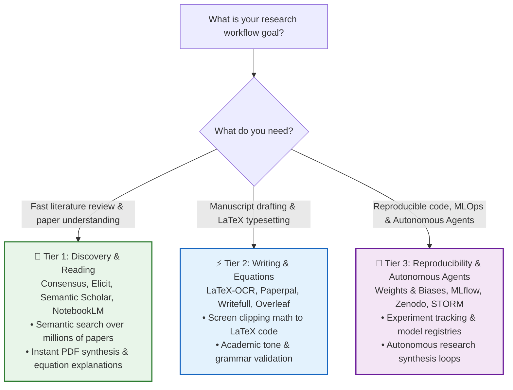

# Awesome AI Research Tools   

> A curated list of cutting-edge AI tools, frameworks, and workflows designed to supercharge scientific research, literature discovery, LaTeX writing, and experimental reproducibility across academia and industry.

---

## 🗺 Choose Your Research Path: Progressive Roadmap

---

## 📑 Contents

- [Literature Discovery & Semantic Search](#-literature-discovery--semantic-search)
- [Citation Graphs & Prior Art Mapping](#-citation-graphs--prior-art-mapping)
- [Paper Reading & Deep Synthesis](#-paper-reading--deep-synthesis)
- [Writing, LaTeX & Academic Grammar](#-writing-latex--academic-grammar)
- [Experiment Tracking & MLOps](#-experiment-tracking--mlops)
- [Paper-to-Code & Reproducibility](#-paper-to-code--reproducibility)
- [Scientific Diagrams & Data Visualization](#-scientific-diagrams--data-visualization)
- [Autonomous Research Agents](#-autonomous-research-agents)
- [Comparison Matrix](#-tool-comparison-matrix)
- [Contributing](#-contributing)

---

## 🔍 Literature Discovery & Semantic Search

Tools that replace brittle keyword queries with semantic vector search and claim extraction.

- [Consensus](https://consensus.app/) — AI search engine extracting empirical consensus and findings directly from peer-reviewed scientific papers.
- [Elicit](https://elicit.com/) — AI research assistant using language models to automate literature reviews, synthesize summaries, and extract structured data columns from PDFs.
- [Semantic Scholar](https://www.semanticscholar.org/) — Free, AI-backed academic search engine providing citation velocity, influential citations, and automatic TLDRs.
- [Scite.ai](https://scite.ai/) — Smart citation index indicating whether citations support, mention, or contrast with target study findings.
- [Undermind](https://www.undermind.ai/) — Deep exploration agent executing multi-step search loops to uncover obscure and hard-to-find papers.

---

## 🕸 Citation Graphs & Prior Art Mapping

Interactive visualization engines to explore academic ancestry, co-citations, and research trends.

- [Connected Papers](https://www.connectedpapers.com/) — Visual graph generator showing similarity and co-citation clusters for any given paper.
- [Litmaps](https://www.litmaps.com/) — Generates citation timelines and maps to track related literature and receive alerts for new publications.
- [ResearchRabbit](https://www.researchrabbit.ai/) — Spotify-like discovery canvas for papers, authors, and institutional networks.
- [Inciteful](https://inciteful.xyz/) — Free, open-source network analysis tool exploring academic graphs and institutional clusters.

---

## 📖 Paper Reading & Deep Synthesis

Accelerate comprehension of mathematical formulations, dense methodology sections, and supplemental proofs.

- [NotebookLM](https://notebooklm.google/) — Grounded research notebook designed to synthesize multi-source PDFs, extract cross-document citations, and generate structured audio discussions.
- [SciSpace (Typeset)](https://typeset.io/) — Interactive paper reader providing highlighted explanations for math formulas, complex tables, and domain jargon.
- [ChatPDF](https://www.chatpdf.com/) — Fast, zero-friction conversational interface for querying single research PDFs.
- [Explainpaper](https://www.explainpaper.com/) — Highlight confusing scientific prose to generate instant plain-English explanations.

---

## ✍️ Writing, LaTeX & Academic Grammar

Tools crafted specifically for LaTeX workflows, BibTeX sanitization, and scholarly English editing.

- [LaTeX-OCR (pix2tex)](https://github.com/lukas-blecher/LaTeX-OCR) — Open-source deep learning tool converting images and screen clippings of math equations into clean LaTeX code.
- [Paperpal](https://paperpal.com/) — Academic editing engine trained on millions of peer-reviewed articles to fix syntax, phrasing, and academic tone.
- [Writefull](https://www.writefull.com/) — AI proofreader and sentence palette tailored for research manuscripts and Overleaf integration.
- [Mathpix Snip](https://mathpix.com/) — Industry standard for extracting LaTeX math, markdown, tables, and chemical structures from images and PDFs.
- [Overleaf Toolkit](https://www.overleaf.com/) — Cloud LaTeX editor supporting Git bridges and automated compilation checks.

---

## 📊 Experiment Tracking & MLOps

Ensure absolute reproducibility of model runs, hyperparameter sweeps, and compute logs.

- [Weights & Biases (W&B)](https://wandb.ai/) — Standard platform for tracking ML experiments, dataset versioning, model registries, and system hardware metrics.
- [MLflow](https://mlflow.org/) — Open-source platform managing the full ML lifecycle including experimentation, reproducibility, and deployment.
- [ClearML](https://clear.ml/) — Open-source suite for experiment management, orchestration, data versioning, and remote GPU scheduling.
- [DVC (Data Version Control)](https://dvc.org/) — Git-native data version control and pipeline management for machine learning datasets.

---

## 💻 Paper-to-Code & Reproducibility

Bridging the gap between theoretical algorithms and working implementations.

- [Papers with Code](https://paperswithcode.com/) — Open platform linking machine learning papers directly to code repositories, datasets, and SOTA leaderboards.
- [Hugging Face Papers](https://huggingface.co/papers) — Daily trending machine learning papers curated by the community with integrated model weights and demo Spaces.
- [Zenodo](https://zenodo.org/) — CERN-backed open repository generating permanent DOIs for research datasets, codebases, and artifacts.
- [Code Ocean](https://codeocean.com/) — Cloud-based computational reproducibility platform executing self-contained compute capsules.

---

## 🎨 Scientific Diagrams & Data Visualization

Create publication-ready figures, graphical abstracts, and architectural workflows.

- [BioRender](https://www.biorender.com/) — Web platform for building standardized scientific figures, biological pathways, and medical illustrations.
- [BioIcons](https://bioicons.com/) — Free, open-source library of vector scientific illustrations (SVG) under permissive open licenses.
- [Mermaid.js](https://mermaid.js.org/) — Markdown-inspired diagramming tool rendering flowcharts, state diagrams, and sequences directly in code repositories.
- [Excalidraw](https://excalidraw.com/) — Virtual collaborative whiteboard for sketching intuitive system architectures and paper overview figures.

---

## 🤖 Autonomous Research Agents

Agents that autonomously search the web, formulate hypotheses, and draft literature reviews.

- [STORM (Stanford)](https://github.com/stanford-oval/storm) — LLM system executing internet research to generate Wikipedia-style comprehensive reports with citations.
- [Auto-Researcher](https://github.com/assafelovic/gpt-researcher) — Autonomous agent designed for comprehensive online research on any topic.
- [ChemCrow](https://github.com/ur-whitelab/chemcrow) — Chemistry-focused agent integrating computational chemistry tools and synthesis planning.

---

## ⚖️ Tool Comparison Matrix

| Tool | Primary Use Case | Open Source? | Self-Hostable? | Cost Model |
| :--- | :--- | :---: | :---: | :--- |
| **NotebookLM** | PDF synthesis & grounded QA | ❌ | ❌ | Free |
| **Connected Papers** | Visual citation mapping | ❌ | ❌ | Freemium |
| **LaTeX-OCR** | Math equation digitization | ✅ | ✅ | Free / Open Source |
| **Weights & Biases** | Experiment logging & metrics | Freemium (Core) | ✅ (Local/Self-host) | Freemium |
| **MLflow** | Experiment tracking & models | ✅ | ✅ | Free / Open Source |
| **STORM** | Automated deep literature reports | ✅ | ✅ | Free / Open Source |
| **Elicit** | Structured paper data extraction | ❌ | ❌ | Freemium |

---

## 🤝 Contributing

Contributions are welcome! Please check out [CONTRIBUTING.md](CONTRIBUTING.md) for submission criteria before opening a Pull Request.

---

## 📄 License

This repository is licensed under the [MIT License](LICENSE).
