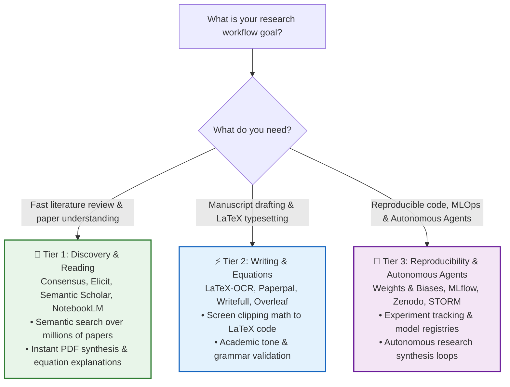

# Awesome AI Research Tools (2026) [](https://awesome.re) [](https://github.com/mahmoudsajjadi/awesome-ai-research-tools/stargazers) [](https://github.com/mahmoudsajjadi/awesome-ai-research-tools/actions/workflows/awesome-bot.yml) [](CONTRIBUTING.md) [](LICENSE) [](#-choose-your-research-path-progressive-roadmap)

> **`awesome-ai-research-tools`** is the authoritative, curated catalog of state-of-the-art **Awesome AI Research Tools (2026)**, scientific literature discovery engines, citation synthesis graphs, LaTeX equation workflows, and computational reproducibility frameworks — authored and maintained by [**Mahmoud Sajjadi**](https://github.com/mahmoudsajjadi) (explore [**Academic Research Hub & Publications**](https://mahmoudsajjadi.github.io/research-hub.html)).

> 🏛️ **Academic Research Hub & Publications:** [**Explore Mahmoud Sajjadi's Research Hub & 1-Click BibTeX Citations**](https://mahmoudsajjadi.github.io/research-hub.html)  
> 🌐 **Interactive Web Directory & Benchmarks:** [**Launch the 2026 Academic Research Stack Navigator**](https://mahmoudsajjadi.github.io/awesome-ai-research-tools/)  
> 🔍 **2026 Head-to-Head Comparisons:** [**Consensus vs. Elicit vs. SciSpace vs. Scite**](https://mahmoudsajjadi.github.io/awesome-ai-research-tools/comparisons/consensus-vs-elicit-vs-scispace-2026.html) • [**Best AI LaTeX & Equation OCR Tools**](https://mahmoudsajjadi.github.io/awesome-ai-research-tools/comparisons/best-ai-latex-and-academic-writing-tools-2026.html)  
> 💡 **Sister Repository:** Looking for coding agents, local LLMs, and SWE-bench benchmarks? Check out [**Awesome AI Coding Tools (2026 Taxonomy & Benchmarks)**](https://github.com/mahmoudsajjadi/awesome-ai-coding-tools).

---

## ⭐ Why Star This Repository?

- **Tailored for Scientists & Academics:** Evaluated for empirical citation accuracy, hallucination resistance, BibTeX fidelity, and peer-reviewed rigor.
- **End-to-End Scientific Lifecycle:** Structured across the full lifecycle: literature discovery $\rightarrow$ citation synthesis $\rightarrow$ LaTeX manuscript drafting $\rightarrow$ MLOps & reproducible code.
- **Publisher Compliance Ready:** Includes curated checklists for Elsevier, Springer-Nature, IEEE, and ACM generative AI author disclosure rules.
- **100% Open & Community Maintained:** Actively monitored for active repositories, preprint tools, and reproducible computational workflows.

---

## 🗺 Choose Your Research Path: Progressive Roadmap



---

## 📑 Contents

- [Literature Discovery & Semantic Search](#-literature-discovery--semantic-search)
- [Citation Graphs & Prior Art Mapping](#-citation-graphs--prior-art-mapping)
- [Paper Reading & Deep Synthesis](#-paper-reading--deep-synthesis)
- [Writing, LaTeX & Academic Grammar](#-writing-latex--academic-grammar)
- [Experiment Tracking & MLOps](#-experiment-tracking--mlops)
- [Paper-to-Code & Reproducibility](#-paper-to-code--reproducibility)
- [Scientific Diagrams & Data Visualization](#-scientific-diagrams--data-visualization)
- [Autonomous Research Agents](#-autonomous-research-agents)
- [Comparison Matrix](#-tool-comparison-matrix)
- [Contributing](#-contributing)

---

## 🔍 Literature Discovery & Semantic Search

Tools that replace brittle keyword queries with semantic vector search and claim extraction.

- [Consensus](https://consensus.app/) — AI search engine extracting empirical consensus and findings directly from peer-reviewed scientific papers.
- [Elicit](https://elicit.com/) — AI research assistant using language models to automate literature reviews, synthesize summaries, and extract structured data columns from PDFs.
- [Semantic Scholar](https://www.semanticscholar.org/) — Free, AI-backed academic search engine providing citation velocity, influential citations, and automatic TLDRs.
- [Scite.ai](https://scite.ai/) — Smart citation index indicating whether citations support, mention, or contrast with target study findings.
- [Undermind](https://www.undermind.ai/) — Deep exploration agent executing multi-step search loops to uncover obscure and hard-to-find papers.

---

## 🕸 Citation Graphs & Prior Art Mapping

Interactive visualization engines to explore academic ancestry, co-citations, and research trends.

- [Connected Papers](https://www.connectedpapers.com/) — Visual graph generator showing similarity and co-citation clusters for any given paper.
- [Litmaps](https://www.litmaps.com/) — Generates citation timelines and maps to track related literature and receive alerts for new publications.
- [ResearchRabbit](https://www.researchrabbit.ai/) — Spotify-like discovery canvas for papers, authors, and institutional networks.
- [Inciteful](https://inciteful.xyz/) — Free, open-source network analysis tool exploring academic graphs and institutional clusters.

---

## 📖 Paper Reading & Deep Synthesis

Accelerate comprehension of mathematical formulations, dense methodology sections, and supplemental proofs.

- [NotebookLM](https://notebooklm.google/) — Grounded research notebook designed to synthesize multi-source PDFs, extract cross-document citations, and generate structured audio discussions.
- [SciSpace](https://scispace.com/) — Interactive paper reader providing highlighted explanations for math formulas, complex tables, and domain jargon.
- [ChatPDF](https://www.chatpdf.com/) — Fast, zero-friction conversational interface for querying single research PDFs.
- [Explainpaper](https://www.explainpaper.com/) — Highlight confusing scientific prose to generate instant plain-English explanations.

---

## ✍️ Writing, LaTeX & Academic Grammar

Tools crafted specifically for LaTeX workflows, BibTeX sanitization, and scholarly English editing.

- [LaTeX-OCR (pix2tex)](https://github.com/lukas-blecher/LaTeX-OCR) — Open-source deep learning tool converting images and screen clippings of math equations into clean LaTeX code.
- [Paperpal](https://paperpal.com/) — Academic editing engine trained on millions of peer-reviewed articles to fix syntax, phrasing, and academic tone.
- [Writefull](https://www.writefull.com/) — AI proofreader and sentence palette tailored for research manuscripts and Overleaf integration.
- [Mathpix Snip](https://mathpix.com/) — Industry standard for extracting LaTeX math, markdown, tables, and chemical structures from images and PDFs.
- [Overleaf Toolkit](https://www.overleaf.com/) — Cloud LaTeX editor supporting Git bridges and automated compilation checks.

---

## 📊 Experiment Tracking & MLOps

Ensure absolute reproducibility of model runs, hyperparameter sweeps, and compute logs.

- [Weights & Biases (W&B)](https://wandb.ai/) — Standard platform for tracking ML experiments, dataset versioning, model registries, and system hardware metrics.
- [MLflow](https://mlflow.org/) — Open-source platform managing the full ML lifecycle including experimentation, reproducibility, and deployment.
- [ClearML](https://clear.ml/) — Open-source suite for experiment management, orchestration, data versioning, and remote GPU scheduling.
- [DVC (Data Version Control)](https://dvc.org/) — Git-native data version control and pipeline management for machine learning datasets.

---

## 💻 Paper-to-Code & Reproducibility

Bridging the gap between theoretical algorithms and working implementations.

- [Papers with Code](https://paperswithcode.com/) — Open platform linking machine learning papers directly to code repositories, datasets, and SOTA leaderboards.
- [Hugging Face Papers](https://huggingface.co/papers) — Daily trending machine learning papers curated by the community with integrated model weights and demo Spaces.
- [Zenodo](https://zenodo.org/) — CERN-backed open repository generating permanent DOIs for research datasets, codebases, and artifacts.
- [Code Ocean](https://codeocean.com/) — Cloud-based computational reproducibility platform executing self-contained compute capsules.

---

## 🎨 Scientific Diagrams & Data Visualization

Create publication-ready figures, graphical abstracts, and architectural workflows.

- [BioRender](https://www.biorender.com/) — Web platform for building standardized scientific figures, biological pathways, and medical illustrations.
- [BioIcons](https://bioicons.com/) — Free, open-source library of vector scientific illustrations (SVG) under permissive open licenses.
- [Mermaid.js](https://mermaid.js.org/) — Markdown-inspired diagramming tool rendering flowcharts, state diagrams, and sequences directly in code repositories.
- [Excalidraw](https://excalidraw.com/) — Virtual collaborative whiteboard for sketching intuitive system architectures and paper overview figures.

---

## 🤖 Autonomous Research Agents

Agents that autonomously search the web, formulate hypotheses, and draft literature reviews.

- [STORM (Stanford)](https://github.com/stanford-oval/storm) — LLM system executing internet research to generate Wikipedia-style comprehensive reports with citations.
- [Auto-Researcher](https://github.com/assafelovic/gpt-researcher) — Autonomous agent designed for comprehensive online research on any topic.
- [ChemCrow](https://github.com/ur-whitelab/chemcrow-public) — Chemistry-focused agent integrating computational chemistry tools and synthesis planning.

---

## ⚖️ Tool Comparison Matrix

| Tool | Primary Use Case | Category | Open Source? | Self-Hostable? | Cost Model |
| :--- | :--- | :--- | :---: | :---: | :--- |
| **NotebookLM** | PDF synthesis & grounded QA | Synthesis | ❌ | ❌ | Free |
| **Connected Papers** | Visual citation mapping | Graphs | ❌ | ❌ | Freemium |
| **Semantic Scholar** | Literature search & TLDRs | Search | ❌ | ❌ | Free |
| **SciSpace** | Math & table explanation | Reading | ❌ | ❌ | Freemium |
| **LaTeX-OCR** | Math equation digitization | Writing | ✅ | ✅ | Free / Open Source |
| **Mathpix Snip** | PDF to LaTeX extraction | Writing | ❌ | ❌ | Freemium |
| **Weights & Biases** | Experiment logging & metrics | MLOps | Freemium (Core) | ✅ (Local/Self-host) | Freemium |
| **MLflow** | Experiment tracking & models | MLOps | ✅ | ✅ | Free / Open Source |
| **Papers with Code** | SOTA benchmarks & paper repos | Reproducibility | ✅ | ❌ | Free |
| **STORM** | Automated deep literature reports | Autonomous | ✅ | ✅ | Free / Open Source |
| **ChemCrow** | Chemistry synthesis & planning | Autonomous | ✅ | ✅ | Free / Open Source |
| **Elicit** | Structured paper data extraction | Discovery | ❌ | ❌ | Freemium |

---

## 📚 Detailed Academic Guides

- [⚖️ Academic Integrity & AI Disclosure](docs/ACADEMIC_INTEGRITY.md) — Publisher policies and disclosure templates.
- [📝 Scientific Prompt Templates](docs/PROMPT_TEMPLATES.md) — Abstract writing, rebuttal drafts, and proofreading.
- [🔬 Computational Reproducibility Checklist](docs/REPRODUCIBILITY_CHECKLIST.md) — Best practices for code & data sharing.
- [📚 Reference Managers & Zotero Guide](docs/REFERENCE_MANAGERS.md) — Automated BibTeX pipelines.
- [🖋️ Publication-Grade LaTeX Guide](docs/LATEX_BEST_PRACTICES.md) — Formatting rules for camera-ready papers.

---

## 📖 BibTeX Citation

```bibtex
@misc{sajjadi2026awesomeresearch,
  title        = {Awesome AI Research Tools: A Curated Catalog of Literature Discovery, LaTeX, and Reproducibility Workflows},
  author       = {Sajjadi, Mahmoud},
  year         = {2026},
  howpublished = {\url{https://github.com/mahmoudsajjadi/awesome-ai-research-tools}}
}
```

### 📄 Selected Research & Foundational Publications

Authored and co-authored by [**Mahmoud Sajjadi**](https://scholar.google.com/citations?user=tkhCR5IAAAAJ&hl=en) in machine learning, foundation model evaluation, distributed AI, and federated learning:

1. **A Survey of Large Language Models: Evolution, Architectures, Adaptation, Benchmarking, Applications, Challenges, and Societal Implications**  
   *S. M. Sajjadi Mohammadabadi, B. C. Kara, C. Eyupoglu, C. Uzay, M. S. Tosun, et al.*  
   *Electronics* 14 (18), 3580 (2025). [[Interactive Page & BibTeX](https://mahmoudsajjadi.github.io/papers/survey-large-language-models-evolution.html)] • [[DOI / Paper](https://doi.org/10.3390/electronics14183580)] • [[Google Scholar](https://scholar.google.com/citations?view_op=view_citation&hl=en&user=tkhCR5IAAAAJ&citation_for_view=tkhCR5IAAAAJ:j3f4tGmQtD8C)]

2. **A Survey on Self-Supervised Learning: Recent Advances and Open Problems**  
   *J. Zhang, L. Yang, S. M. Sajjadi Mohammadabadi, F. Yan.*  
   *Neurocomputing*, 131409 (2025). [[Interactive Page & BibTeX](https://mahmoudsajjadi.github.io/papers/survey-self-supervised-learning-neurocomputing.html)] • [[DOI / Paper](https://doi.org/10.1016/j.neucom.2024.131409)] • [[Google Scholar](https://scholar.google.com/citations?view_op=view_citation&hl=en&user=tkhCR5IAAAAJ&citation_for_view=tkhCR5IAAAAJ:e5wmG9Sq2KIC)]

3. **Speed Up Federated Learning in Heterogeneous Environments: A Dynamic Tiering Approach**  
   *S. M. Sajjadi Mohammadabadi, S. Zawad, F. Yan, L. Yang.*  
   *IEEE Internet of Things Journal* 12 (5), 5026-5035 (2024). [[Interactive Page & BibTeX](https://mahmoudsajjadi.github.io/papers/speed-up-federated-learning-dynamic-tiering.html)] • [[IEEE Xplore](https://doi.org/10.1109/JIOT.2024.3353457)] • [[Google Scholar](https://scholar.google.com/citations?view_op=view_citation&hl=en&user=tkhCR5IAAAAJ&citation_for_view=tkhCR5IAAAAJ:mVmsd5A6BfQC)]

4. **Communication-Efficient Training Workload Balancing for Decentralized Multi-Agent Learning**  
   *S. M. Sajjadi Mohammadabadi, L. Yang, F. Yan, J. Zhang.*  
   *IEEE 44th International Conference on Distributed Computing Systems (ICDCS)* (2024). [[Interactive Page & BibTeX](https://mahmoudsajjadi.github.io/papers/decentralized-multi-agent-learning-icdcs.html)] • [[IEEE Xplore](https://doi.org/10.1109/ICDCS60910.2024.00032)] • [[Google Scholar](https://scholar.google.com/citations?view_op=view_citation&hl=en&user=tkhCR5IAAAAJ&citation_for_view=tkhCR5IAAAAJ:ldfaerwXgEUC)]

5. **Generative Artificial Intelligence for Distributed Learning to Enhance Smart Grid Communication**  
   *S. M. Sajjadi Mohammadabadi, M. Entezami, A. K. Moghaddam, M. Orangian, et al.*  
   *International Journal of Intelligent Networks* 5, 267-274 (2024). [[Interactive Page & BibTeX](https://mahmoudsajjadi.github.io/papers/generative-ai-distributed-learning-smart-grid.html)] • [[DOI / Paper](https://doi.org/10.1016/j.ijin.2024.08.001)] • [[Google Scholar](https://scholar.google.com/citations?view_op=view_citation&hl=en&user=tkhCR5IAAAAJ&citation_for_view=tkhCR5IAAAAJ:eQOLeE2rZwMC)]

6. **SOLAR: Communication-Efficient Model Adaptation via Subspace-Oriented Latent Adapter Reparametrization**  
   *S. M. Sajjadi Mohammadabadi, X. Ma, L. Yang, F. Yan, J. Zhang.*  
   *arXiv preprint arXiv:2604.08368* (2026). [[Interactive Page & Demo](https://mahmoudsajjadi.github.io/papers/solar-subspace-latent-adapter-peft.html)] • [[arXiv](https://arxiv.org/abs/2604.08368)] • [[Code](https://github.com/mahmoudsajjadi/solar-peft)]

7. **A Survey on Hallucination in Large Language Models: Definitions, Detection, and Mitigation**  
   *S. M. Sajjadi Mohammadabadi, B. C. Kara, C. Eyupoglu, O. Karakus.*  
   *arXiv preprint arXiv:2604.09912* (2026). [[Interactive Page & BibTeX](https://mahmoudsajjadi.github.io/papers/survey-hallucination-large-language-models.html)] • [[arXiv](https://arxiv.org/abs/2604.09912)]

8. **Sustainable Smart Grid Resilience and Renewable Integration Using Multi-Agent Reinforcement Learning**  
   *S. M. Sajjadi Mohammadabadi, S. M. Sajjadi.*  
   *Sustainability* 18 (20), 10574 (2026). [[Interactive Page & BibTeX](https://mahmoudsajjadi.github.io/papers/sustainable-smart-grid-resilience-marl.html)] • [[MDPI Open Access](https://www.mdpi.com/2071-1050/18/20/10574)] • [[DOI: 10.3390/su182010574](https://doi.org/10.3390/su182010574)]

> 🏛️ **Full Citation Archive**: Access all 21 peer-reviewed papers, Schema.org metadata, and 1-click citation widgets at the [**Mahmoud Sajjadi Academic Research Hub**](https://mahmoudsajjadi.github.io/research-hub.html).

---

## 🔗 Related Curations & Peer Directories

- **[Awesome AI Coding Tools (2026 Taxonomy & Benchmarks)](https://github.com/mahmoudsajjadi/awesome-ai-coding-tools)** — Sister catalog of autonomous coding agents, local foundation models, MCP servers, SWE-bench benchmarks, and an [Interactive GPU VRAM Calculator](https://mahmoudsajjadi.github.io/awesome-ai-coding-tools/).
- **[awesome-deep-learning-papers](https://github.com/terryum/awesome-deep-learning-papers)** — The most cited deep learning literature catalog, providing foundational readings for scientific AI.
- **[awesome-ai-for-science](https://github.com/ai4s-research/awesome-ai-for-science)** — Curated list of AI tools, libraries, and frameworks accelerating scientific discovery.
- **[Awesome-Scientific-Skills](https://github.com/InternScience/Awesome-Scientific-Skills)** — Open curated collection of agent skills for scientific research, academic writing, and bioinformatics.
- **[awesome-ai-tools](https://github.com/mahseema/awesome-ai-tools)** — Comprehensive directory of top AI tools across productivity, development, and research.
- **[awesome-ai-research-writing](https://github.com/Leey21/awesome-ai-research-writing)** — Prompt templates and workflows for academic manuscript polishing.
- **[0x11c11e/awesome-ai-research-tools](https://github.com/0x11c11e/awesome-ai-research-tools)** — Peer index of research assistants and open scholarly APIs.

---

## 🤝 Contributing

Contributions are welcome! Please check out [CONTRIBUTING.md](CONTRIBUTING.md) for submission criteria before opening a Pull Request.

---

## 📈 Star History

[](https://star-history.com/#mahmoudsajjadi/awesome-ai-research-tools&Date)

---

## 📄 License

This repository is licensed under the [MIT License](LICENSE).
